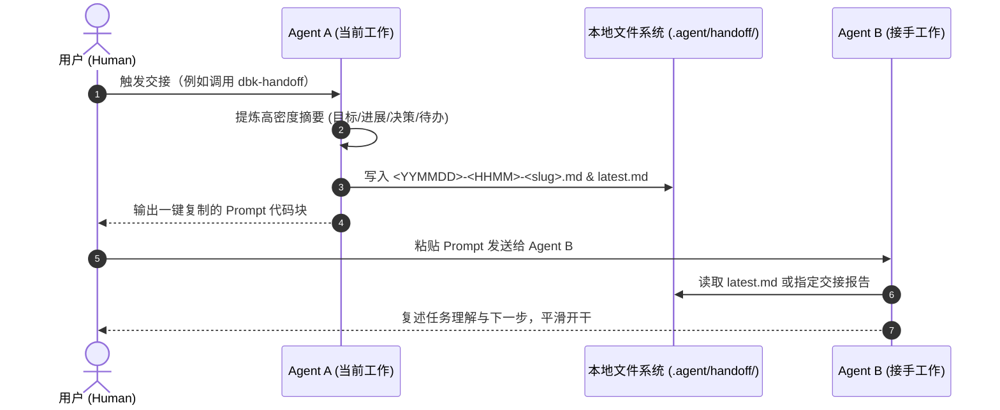

# dbk-handoff 设计规范与架构文档

> **项目定位**：轻量级、跨 AI Agent 的通用上下文交接与断点续跑协议。
> **适用场景**：在不同的 AI Agent（如 Antigravity, Claude Code, Cursor, Windsurf, OpenHands 等）之间无缝切换，实现上下文渐进式传递，兼顾 Token 经济性与任务连续性。

---

## 1. 核心命名规范

| 维度 | 标识 / 名称 | 说明 |
| :--- | :--- | :--- |
| **开源仓库名** | `dbk-handoff` | 统一开源仓库与品牌标识 |
| **发出端 Skill** | `dbk-handoff` | 总结当前进度、写入上下文报告、生成引导 Prompt |
| **接收端 Skill** | `dbk-pickup` | 接管任务、读取交接报告、向用户确认后继续执行 |
| **报告存储目录** | `.agent/handoff/` | 位于当前工作区（Workspace）根目录下 |
| **最新快照副本** | `.agent/handoff/latest.md` | 最新一份快照的完整拷贝，方便免参快速读取；文件内 `snapshot` 字段指向权威快照 |

---

## 2. 存储与文件命名规范

### 2.1 目录结构
```text
<workspace-root>/
├── .agent/
│   └── handoff/
│       ├── .gitignore                        # 自动生成：默认忽略目录内所有快照文件
│       ├── latest.md                         # 最新快照的完整拷贝（snapshot 字段指向权威快照）
│       ├── 261018-1230-auth-refactor.md      # 历史交接快照 1
│       └── 261018-1420-fix-token-expiry.md   # 历史交接快照 2
└── ... (项目业务代码)
```

### 2.2 文件名格式与 Git 忽略机制
- **自动忽略保障**：当首次创建 `.agent/handoff/` 目录时，若该目录下不存在 `.gitignore`，自动写入以下内容（自闭环忽略，不污染用户业务 Git 仓库）：
  ```gitignore
  # 忽略所有交接快照和临时文件
  *
  # 保留本忽略文件自身
  !.gitignore
  ```
- **命名模板**：`<YYMMDD>-<HHMM>-<简短主题>.md`
  - `YYMMDD`：两位年+两位月+两位日（基于生成笔记时的本地时间，如 `261018`）
  - `HHMM`：两位24小时制时+分（如 `1230`）
  - `<简短主题>`：全小写英文，单词间使用半角短横线 `-` 连接，控制在 2~5 个单词以内（如 `auth-refactor`、`fix-token-expiry`）
- **示例**：`261018-1230-auth-refactor.md`
- **不变性原则**：目录中已生成的旧笔记不回溯改名，保障历史引用路径有效。

### 2.3 架构决策：为什么 `latest.md` 采用全量内容覆写而非软链接 (Symlink)？
- **背景与权衡**：
  在早期讨论中曾考虑使用符号链接（Symlink）或指针文件指向最新快照。
- **最终决策**：采用 **全量内容直接覆写拷贝（Full Copy & Overwrite）**。
- **核心理由**：
  1. **跨平台与权限兼容性（关键痛点）**：Windows 操作系统默认需要管理员权限或启用开发者模式才能创建符号链接（`mklink`），普通终端/Agent 会频发 `Access is denied` 错误；在 WSL、Docker、不同文件系统间切换时也极易断链。
  2. **避免多余 Tool Call 交互**：接手 Agent 兜底读取 `latest.md` 时，一步读完即可获得完整高密度上下文，无需二次跳转解引用。
  3. **体积微乎其微**：单份交接文档通常仅 1~3 KB，双写不会对存储带来任何可见开销。
- **快照归属**：`latest.md` 不是指针，而是最新快照的完整拷贝。报告模板中的 `snapshot` 字段记录该内容的权威快照文件名，因此即使 `latest.md` 被后续交接覆盖，读取者仍能据此回溯历史快照。`snapshot` 必须与写入时的快照文件名一致，两份文件内容保持完全一致。

### 2.4 报告元数据（YAML Frontmatter）

每份交接报告开头必须包含 YAML frontmatter，用于版本校验、状态比对和机器解析：

| 字段 | 必填 | 说明 |
| :--- | :--- | :--- |
| `handoff_version` | 是 | 协议版本，当前为 `1`；不兼容变更时递增主版本号。 |
| `created` | 是 | 生成时间，ISO 8601 格式并带时区偏移，如 `"2026-10-18T12:30:00+08:00"`；建议加引号，避免被 YAML 解析器自动转成时间类型。 |
| `snapshot` | 是 | 权威快照文件名，必须与当前文件名一致；`latest.md` 内同样保留该字段。 |
| `workspace` | 是 | 工作区根目录的绝对路径。 |
| `source_agent` | 是 | 生成报告的 Agent 标识，如 `claude-code`、`cursor`。 |
| `source_model` | 否 | 生成报告的模型标识。 |
| `task` | 是 | 简短任务主题，与文件名中的 `<简短主题>` 对应。 |
| `git` | 否 | 仓库状态：`branch`、`head`（短 SHA）、`dirty`（是否有未提交改动）。非 Git 工作区可省略。`dirty` 在写入本次交接文件之前采集，且忽略 `.agent/` 路径，避免交接产物本身把工作区标记为脏。 |
| `transcript` | 否 | 原 Agent 会话日志的绝对路径（仅在当前客户端环境显式暴露路径时填写，未暴露时省略，禁止盲搜或猜测路径）。 |

- 未知字段应被忽略，以保证向后兼容。
- 接手端读取到高于自身支持版本的 `handoff_version` 时，必须提示用户并降级为人工阅读，不得按旧规则解析。
- `git` 字段用于判断交接后工作区是否已发生变化；不一致时接手端应先向用户确认。

---

## 3. 工作流程（Workflows）



---

## 4. 核心 Skill 设计细节

### 4.1 发出端：`dbk-handoff`

> **设计参考来源**：本交接报告格式深度吸收了 **`can1357/oh-my-pi` (omp)** 的 session handoff 机制与设计哲学。omp 证明了通过高密度结构化交接，可以避免接手 Agent 展开低效的“代码考古搜索（File Archaeology）”，并将已被排除的死胡同方案（Dead Ends）前置锁定，防止新 Agent 走回头路。

#### 报告提炼要素与执行步骤：
1. **分析当前上下文**：提炼以下核心要素，并写入标准化报告：
   - **📋 报告元数据 (Frontmatter)**：按 §2.4 填写 `handoff_version`、`created`、`snapshot`、`workspace`、`source_agent`、`source_model`、`task`、`git` 状态与可选的 `transcript`。
   - **🎯 任务目标 (Goal & Scope)**：原始用户需求与最终验收交付标准。
   - **📂 核心工作集 (Key Files & Working Set - 吸收自 omp)**：明确列出 5~15 个关键文件路径（被修改的文件、核心依赖、测试用例、配置文件），并附带一句话角色说明，避免新 Agent 盲目全局 grep。
   - **✅ 已完成进展 (Completed Work)**：修改了哪些文件、跑通了哪些功能。
   - **💡 关键决策与避坑指南 (Decisions & Dead Ends - 吸收自 omp)**：为什么采用该方案，**特别记录尝试过但失败的方案与踩坑点**，明令禁止接手 Agent 重复踩坑。
   - **⏳ 当前停顿点与下一步待办 (Next Steps)**：明确当前精确卡在哪个具体代码位置，下一步立即执行的有序待办列表。
   - **🧪 验证与自测方案 (Verification Plan - 吸收自 omp)**：接手 Agent 编写完代码后应运行的验证命令（如 `npm test`、`cargo check`、`pytest` 等）。
   - **📜 原始会话日志 (Raw Transcript Path，可选)**：仅当当前环境显式暴露本地会话日志路径时，记录其绝对路径作为兜底依据（写入 frontmatter 的 `transcript` 字段及引导 Prompt），未暴露时直接省略，禁止搜索宿主目录或猜测路径。

2. **写盘归档**：
   - 检查 `.agent/handoff/` 目录，若首次创建则自动放置 `.gitignore`。
   - 按照 `<YYMMDD>-<HHMM>-<简短主题>.md` 写入交接快照，frontmatter 中的 `snapshot` 填写该文件名，并与 `created`、`git` 等元数据保持一致。
   - 同步覆盖写入一份内容完全相同的副本至 `.agent/handoff/latest.md`。

3. **生成的标准交接报告模板示例（`.agent/handoff/<slug>.md`）**：
   ```markdown
   ---
   handoff_version: 1
   created: "<YYYY-MM-DDTHH:MM:SS+08:00>"
   snapshot: <YYMMDD>-<HHMM>-<简短主题>.md
   workspace: <工作区绝对路径>
   source_agent: <agent 标识>
   source_model: <model-id>
   task: <简短主题>
   git: { branch: <branch>, head: <short-sha>, dirty: <true|false> }
   transcript: <transcript 绝对路径，客户端未暴露时省略本行>
   ---
   # Handoff: <简短主题>

   ## 🎯 任务目标 (Goal)
   <简述任务目标与交付标准>

   ## 📂 核心工作集 (Key Files & Working Set)
   - `<文件相对/绝对路径>`: <该文件在任务中的角色/修改点>
   - `<测试文件路径>`: <相关测试用例>

   ## ✅ 已完成事项 (Completed)
   - <已完成修改与验证成果>

   ## 💡 关键决策与避坑指南 (Decisions & Dead Ends)
   - **采用方案**: <为什么这样设计>
   - **已踩坑/已排除**: <尝试过但失败的做法，提醒接手 Agent 绝对不要重复该方案>

   ## ⏳ 当前停顿点与下一步待办 (Next Steps)
   - 当前停顿点: <停留在哪个具体文件/哪行代码/哪个未解决的问题>
   - [ ] 待办 1: ...
   - [ ] 待办 2: ...

   ## 🧪 验证与自测方案 (Verification)
   - `<自测执行命令，例如 pytest / npm test / cargo test 等>`
   ```

4. **吐出引导 Prompt**：在控制台最后以 Markdown 代码块输出一段预制提示词，方便用户直接复制到下一个 Agent。

#### 吐出的引导 Prompt 模板示例：
````markdown
--- [请复制以下内容发送给接手 Agent] ---
我在使用另一个 AI 协助开发，现需要你接手该任务。

【前置检查】
请检查你是否已安装 `dbk-pickup` skill。若未安装，请先装上该 skill（如 `npx skills add DBinK/dbk-handoff -g -y`）并重新加载 skills，再调用 `dbk-pickup`。

【接手指引】
请调用 `dbk-pickup` skill 并结合以下信息开展工作：
- 项目根目录：<工作区绝对路径>
- 交接报告路径：<工作区绝对路径>/.agent/handoff/<YYMMDD>-<HHMM>-<简短主题>.md
- 原 Agent 完整对话记录（仅在报告细节不足时按需查阅，请勿盲目全读）：<原Agent日志绝对路径，若客户端未暴露则省略本行>

请先阅读交接报告，用简短几句话向我确认你已理清当前现状和下一步，然后再继续执行任务。
----------------------------------------
````

---

### 4.2 接收端：`dbk-pickup`
#### 职责与渐进式加载（Progressive Disclosure）原则：

本 Skill 是读取交接报告的唯一入口。未加载本 Skill 指引时，Agent 不得直接裸读 `latest.md` 或历史快照——路径解析、版本校验、Git 状态比对与 Transcript 访问约束均定义在本 Skill 中。

1. **报告路径解析顺序（精准优先，latest.md 兜底）**：
   - **显式指定**：如果用户或引导 Prompt 中提供了具体的交接报告路径（如 `<工作区绝对路径>/.agent/handoff/<YYMMDD>-<HHMM>-<slug>.md`），**必须精准读取该指定文件**。
   - **缺省兜底**：如果用户直接调用 `/dbk-pickup`（没有任何附加参数或引导 Prompt），则默认兜底读取 `.agent/handoff/latest.md`。由于 `latest.md` 与权威快照内容完全一致，读取后即可直接使用其正文，无需再次读取 `snapshot` 字段指向的同名快照文件（`snapshot` 字段仅用于标识快照归属与历史回溯）。
   - 读取后提取核心内容：任务目标、工作集清单、进度、避坑提醒、下一步待办与自测命令。
   - **元数据校验**：确认 `handoff_version` 在支持范围内，对比报告中的 `git.branch`、`git.head`、`git.dirty` 与当前仓库状态。若不一致，先告知用户“交接后工作区已发生变化”，确认后再执行待办。
2. **防 Token 爆炸约束（核心安全机制）**：
   - **严禁主动一次性通读原 Agent 的完整 Transcript 文件**。只有在交接报告中存在严重缺失、报告提供了 `transcript` 路径且用户授权时，才按需检索特定行范围。
3. **向用户对齐状态**：
   - 读取完毕后，用简短 3~4 句话向用户汇报：已理解的目标、下一步将要做什么。
   - 获得用户确认或直接开启第一步行动。

---

## 5. 仓库文件组织

```text
dbk-handoff/
├── README.md               # 项目介绍、跨 Agent 支持情况、快速上手指引
├── ARCHITECTURE.md         # 架构设计与协议标准（本文档）
├── AGENTS.md               # Agent / 贡献者工作约定与校验命令
├── CHANGELOG.md            # 变更记录（Keep a Changelog）
├── LICENSE                 # MIT
└── skills/
    ├── dbk-handoff/
    │   ├── SKILL.md        # dbk-handoff Skill 规范定义
    │   └── evals/
    │       └── trigger-queries.json
    └── dbk-pickup/
        ├── SKILL.md        # dbk-pickup Skill 规范定义
        └── evals/
            └── trigger-queries.json
```
