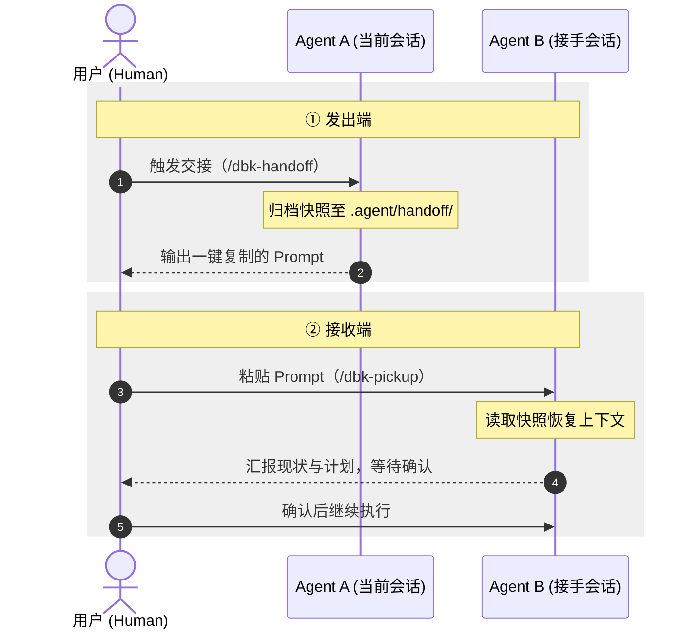

# dbk-handoff

<p align="center">
  
</p>

---

[](https://skills.sh/DBinK/dbk-handoff)
[](https://github.com/DBinK/dbk-handoff/stargazers)
[](LICENSE)
 [](README.md#工作流程)
[](README.md#核心特性)

> **用于跨 AI Agent 会话接力的 Agent Skills**

在 omp、pi、dsh、Codex、Claude Code、Antigravity 等工具间切换或开启新会话时，开发上下文会随之中断。新会话因缺少前序状态，往往需要重新检索代码库、重复尝试已排除的方案，或在未对齐当前进度的情况下直接修改代码

本项目提供两个配套 Skill，通过本地 Markdown 快照（`.agent/handoff/xxx.md`）传递任务状态：
- `/dbk-handoff`: 负责提炼任务进度、需求对照矩阵、核心文件与已排除方案，**生成本地快照文档**与引导词
- `/dbk-pickup`: 负责在新会话中校验 Git 工作区状态、汇报当前断点，并**暂停等待人工确认**后再继续执行

---

## 工作流程



---

## 核心特性

- **自适应双轨制（Dual-Track）**：
  - **敏捷自由模式**：日常开发或快速修 bug，一键归档当前技术断点与核心工作集。
  - **规范基线模式（Spec-Driven）**：提供 PRD / 技术方案 / 需求单时，自动提炼**结构化需求对照矩阵**，宏观完成度（如 `[2/4]`）一目了然。
- **汇报后强制暂停（人工确认环）**：接手 Agent 读完报告后**默认暂停并等待确认**，避免在未对齐理解前直接修改代码。
- **防重复考古（Dead Ends 前置）**：继承自 [`can1357/oh-my-pi`](https://github.com/can1357/oh-my-pi)（omp）哲学，限定 5~15 个核心工作集，前置锁定已排除的死胡同方案。
- **渐进式加载防爆炸**：优先读取 1~3 KB 的精炼快照，原始会话日志（Transcript）仅作最后兜底且必须按需局部检索。
- **零仓库污染**：快照目录 `.agent/handoff/` 自动写入 `*` 忽略规则，将快照与忽略文件自身一并忽略，不污染业务 Git 仓库。

<details>
<summary>📄 <b>点击展开：生成的标准化交接报告示例（带需求对照矩阵）</b></summary>

```markdown
---
handoff_version: 1
created: "2026-10-22T10:30:00+08:00"
snapshot: 261022-1030-auth-refactor.md
workspace: /Users/binn/it/my-project
source_agent: claude-code
source_model: claude-sonnet-4
task: auth-refactor
spec: docs/rfcs/auth-v2.md
git: { branch: main, head: 11670ce, dirty: true }
---
# Handoff: auth-refactor

## 📋 需求与交付基线 (Spec & Baseline)
- **需求基准**: `docs/rfcs/auth-v2.md`
- **对照进度**: [2/4] 已完成 2 项，1 项进行中，1 项待开工

| 需求条目 / 功能点 | 状态 | 对应代码 / 验证状态 |
| :--- | :---: | :--- |
| 1. OAuth2 鉴权与租户隔离 | ✅ 已完成 | `src/auth/`（端到端测试均通过） |
| 2. Token 无感刷新机制 | ✅ 已完成 | `src/token.rs`（过期自旋测试通过） |
| 3. RBAC 权限过滤中间件 | 🚧 进行中 | `src/middleware/auth.rs`（**当前停顿点**：类型已定义，待补全拦截逻辑） |
| 4. 敏感操作二次验证与审计 | ⏳ 待开工 | 暂未触及 |

## 📂 核心工作集 (Key Files & Working Set)
- `src/middleware/auth.rs`: 核心权限拦截器，当前停顿位置（未提交）
- `src/token.rs`: Token 刷新核心实现
- `tests/auth_test.rs`: 鉴权集成测试用例

## ✅ 已完成事项 (Completed)
- 跑通 OAuth2 登录换票流程与租户 ID 绑定
- 完成 Token 自动刷新与本地缓存淘汰

## 💡 关键决策与避坑指南 (Decisions & Dead Ends)
- **采用方案**: 基于 Header 中的 Claims 进行租户隔离。
- **已踩坑/已排除**: 曾尝试在全局 Middleware 里直接解析数据库 Session，在高并发下引起连接池耗尽，已被彻底排除，切勿退回该方案。

## ⏳ 当前停顿点与下一步待办 (Next Steps)
- 当前停顿点: `src/middleware/auth.rs` 第 42 行，待实现 `check_role_permission` 校验函数
- [ ] 待办 1: 在 `src/middleware/auth.rs` 补齐角色权限比对逻辑
- [ ] 待办 2: 运行 `cargo test --test auth_test` 验证闭环

## 🧪 验证与自测方案 (Verification)
- `cargo test --test auth_test`
```

</details>

---

## 与同类方案的关系

`dbk-handoff` 并非替代现有的 Agent 工具，而是与现有生态分工协作、互为补充：

| 方案 | 它解决什么（优势） | 与 dbk-handoff 的互补关系 |
| :--- | :--- | :--- |
| **客户端内置 `/compact`**<br>([Claude Code 文档](https://platform.claude.com/docs/en/build-with-claude/compaction)) | **会话内上下文压缩**：在单个 Agent 窗口内精简历史消息，降低单次长会话的 Token 消耗。 | **补齐跨环境断点**：`/compact` 无法跨窗口或跨 IDE 传递，`dbk-handoff` 负责在换窗口或换 Agent 时无缝接力。 |
| **Claude Code `MEMORY.md` / Mem0**<br>([Claude 文档](https://docs.anthropic.com/en/docs/agents-and-tools/claude-code/overview) / [Mem0 官网](https://mem0.ai)) | **全局长期记忆与偏好**：沉淀跨项目的通用经验、个人开发偏好与项目长期认知（常驻后台）。 | **全局偏好 vs 单次任务断点**：长期记忆不感知“当前这次开发写到了第几步、卡在哪行代码”，`dbk-handoff` 专记单次任务的高密度动态断点，即用即走。 |
| **`AGENTS.md` / `CLAUDE.md`**<br>([Agent Skills 规范](https://agentskills.io)) | **长期静态规则库**：常驻仓库根目录，定义技术栈要求、编码风格与构建测试命令。 | **动静互补**：规则文件管“静态通用标准”，不记录任务动态进展，`dbk-handoff` 专记“当前进度矩阵与已排除的踩坑方案”。 |
| **GitHub Spec Kit**<br>([github/spec-kit](https://github.com/github/spec-kit)) | **需求落地全流程**：通过 `specify → plan → tasks → implement` 完成宏观需求拆解。 | **宏观规划 vs 微观接力**：Spec Kit 负责定义“要做什么”，`dbk-handoff` 在具体实现切换工具时，提供“当前交付完成度与精准代码断点”。 |
| **omp `/handoff`**<br>([can1357/oh-my-pi](https://github.com/can1357/oh-my-pi)) | **会话交接原型**：本项目设计灵感来源，首创了显式记录“已排除方案”与“核心工作集”的交接机制。 | **继承与泛化**：本项目继承其精炼理念，进一步扩展为**跨客户端 Skill**，并增加了**需求对照矩阵**与**接手强制暂停确认环**。 |

> 注：以上依据各项目公开文档描述其核心能力边界，若随版本迭代有出入，欢迎提交 Issue 探讨校准。

---

## 快速上手

### 1. 安装

```bash
npx skills add DBinK/dbk-handoff -g -y
```

### 2. 两步完成交接

1. **发出交接（Agent A）**：在当前窗口告诉 Agent `做个交接`（有 PRD 时可说 `对照 prd.md 做交接`）。它会在 `.agent/handoff/` 生成快照并输出一段引导 Prompt。
2. **接手任务（Agent B）**：在新窗口直接粘贴引导 Prompt。接手 Agent 会调用 `dbk-pickup` 汇报理解并**停下来等待确认**，你确认后再开干。

<details>
<summary>📋 <b>点击展开：粘贴给 Agent B 的引导 Prompt 示例</b></summary>

````text
--- [请复制以下内容发送给接手 Agent] ---

我需要将以下开发任务交接给你继续推进：

- **任务目标**：完成鉴权模块重构与测试闭环
- **当前进度**：对照需求文档已完成 [2/4]，正处于第 3 项（RBAC 中间件编写中）
- **项目目录**：/Users/binn/it/my-project
- **交接报告**：/Users/binn/it/my-project/.agent/handoff/261022-1030-auth-refactor.md

**接手要求**：
1. 请先确认已安装 `dbk-pickup` skill，未安装时先运行 `npx skills add DBinK/dbk-handoff -g -y`。
2. 调用 `dbk-pickup` 读取交接报告，用简短几句话向我汇报你理解的现状与下一步计划。
3. 原会话记录仅作兜底，只在报告细节缺失时按需局部检索，切勿全量读取。
4. **汇报完毕后请直接暂停并等待我确认**，确认前禁止修改任何文件或执行非只读命令。

----------------------------------------
````

</details>

<details>
<summary>🤖 <b>点击展开：接手 Agent 的安全复述效果</b></summary>

> “已读取交接报告 `261022-1030-auth-refactor.md`，工作区 Git 状态与交接时一致。  
> 对照需求文档当前整体进度为 [2/4]，前两项 OAuth2 与 Token 刷新已跑通；目前正停留在第 3 项（RBAC 中间件编写）。我已明确排除全局 Session 方案的避坑提示，下一步计划在 `src/middleware/auth.rs` 实现角色鉴权函数并运行自测。  
> 我已就绪，请确认是否继续？”

</details>

---

## 组成

| 技能 | 角色 | 核心职责 |
| :--- | :--- | :--- |
| **`dbk-handoff`** | 发出端 | 提炼任务目标（或需求矩阵）、核心工作集、避坑指南与下一步待办，双写快照并输出引导 Prompt。 |
| **`dbk-pickup`** | 接收端 | 按规则读取快照，校验协议版本与 Git 状态，向用户汇报现状后**暂停等待确认**。 |

---

## 目录结构

```text
<workspace-root>/
├── .agent/
│   └── handoff/
│       ├── .gitignore                        # 自动忽略快照与自身，保证工作区整洁
│       ├── latest.md                         # 最新快照的全量副本（方便免参读取）
│       ├── 261022-1030-auth-refactor.md      # 历史交接快照 1
│       └── 261022-1420-fix-token-expiry.md   # 历史交接快照 2
└── ... (业务代码)
```

---

## 文档

- [ARCHITECTURE.md](ARCHITECTURE.md) — 存储规范、元数据全集、工作流序列图与 Skill 深度设计
- [AGENTS.md](AGENTS.md) — 面向协作 Agent 与开发者的约定与校验命令
- [CHANGELOG.md](CHANGELOG.md) — 变更日志（基于 Keep a Changelog）

## 致谢

- [`can1357/oh-my-pi`](https://github.com/can1357/oh-my-pi)（omp）：感谢其极具前瞻性的 `/handoff` 机制与上下文工程哲学。本项目深度借鉴了 omp 对 **核心工作集（Key Files）**、**死胡同方案（Dead Ends）前置锁定** 与 **验证闭环（Verification Plan）** 的严格定义，从而彻底告别低效的代码考古。

## 许可

[MIT](LICENSE)
