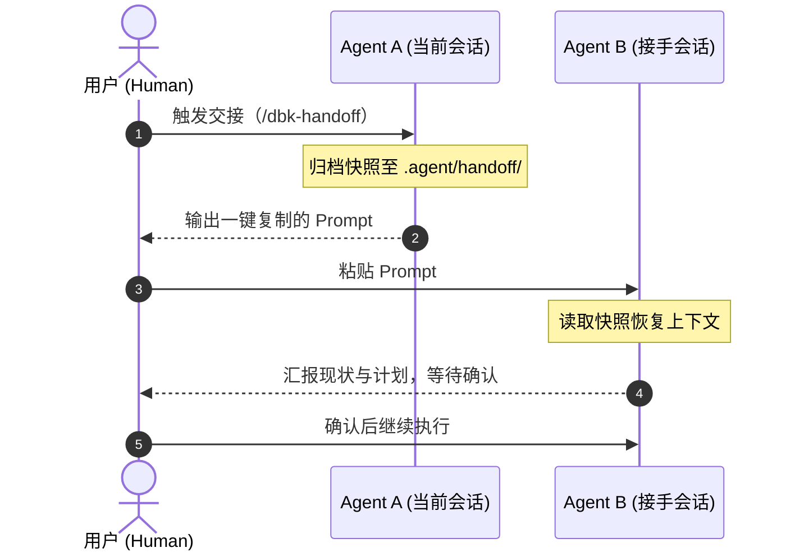

# dbk-handoff

[](https://skills.sh/DBinK/dbk-handoff)
[](https://agentskills.io)
[](ARCHITECTURE.md)
[](LICENSE)

> **跨 AI Agent 的通用上下文交接与需求交付基线协议**

在 Claude Code、Cursor、Windsurf、OpenHands、Antigravity、pi 等工具之间切换或新开会话时，新 Agent 往往缺少前序上下文：要么全仓盲目搜索、重复踩已排除的坑，要么面对长篇 PRD/技术方案丢失全局坐标、拿完指令直接无脑开改。

`dbk-handoff` 是一套纯文件、免后端的标准化交接协议：发出端归档高密度快照，接收端受控接手，全程零服务依赖。

---

## 工作流程



---

## 快速上手

### 1. 安装

```bash
npx skills add DBinK/dbk-handoff -g -y
```

### 2. 两步完成交接

1. **发出交接（Agent A）**：在当前窗口告诉 Agent `做个交接`（有 PRD 时可说 `对照 prd.md 做交接`）。它会在 `.agent/handoff/` 生成快照并输出一段引导 Prompt。
2. **接手任务（Agent B）**：在新窗口直接粘贴引导 Prompt。接手 Agent 会调用 `dbk-pickup` 汇报理解并**停下来等待确认**，你确认后再开干。

<details>
<summary>📋 <b>点击展开：粘贴给 Agent B 的引导 Prompt 示例</b></summary>

````text
--- [请复制以下内容发送给接手 Agent] ---

我需要将以下开发任务交接给你继续推进：

- **任务目标**：完成鉴权模块重构与测试闭环
- **当前进度**：对照需求文档已完成 [2/4]，正处于第 3 项（RBAC 中间件编写中）
- **项目目录**：/Users/binn/it/my-project
- **交接报告**：/Users/binn/it/my-project/.agent/handoff/261022-1030-auth-refactor.md

**接手要求**：
1. 请先确认已安装 `dbk-pickup` skill，未安装时先运行 `npx skills add DBinK/dbk-handoff -g -y`。
2. 调用 `dbk-pickup` 读取交接报告，用简短几句话向我汇报你理解的现状与下一步计划。
3. 原会话记录仅作兜底，只在报告细节缺失时按需局部检索，切勿全量读取。
4. **汇报完毕后请直接暂停并等待我确认**，确认前禁止修改任何文件或执行非只读命令。

----------------------------------------
````

</details>

<details>
<summary>🤖 <b>点击展开：接手 Agent 的安全复述效果</b></summary>

> “已读取交接报告 `261022-1030-auth-refactor.md`，工作区 Git 状态与交接时一致。  
> 对照需求文档当前整体进度为 [2/4]，前两项 OAuth2 与 Token 刷新已跑通；目前正停留在第 3 项（RBAC 中间件编写）。我已明确排除全局 Session 方案的避坑提示，下一步计划在 `src/middleware/auth.rs` 实现角色鉴权函数并运行自测。  
> 我已就绪，请确认是否继续？”

</details>

---

## 核心特性

- **自适应双轨制（Dual-Track）**：
  - **敏捷自由模式**：日常开发或快速修 bug，一键归档当前技术断点与核心工作集。
  - **规范基线模式（Spec-Driven）**：提供 PRD / 技术方案 / 需求单时，自动提炼**结构化需求对照矩阵**，宏观完成度（如 `[2/4]`）一目了然。
- **汇报后强制暂停（人工确认环）**：接手 Agent 读完报告后**默认暂停并等待确认**，杜绝无脑直接动手改错代码。
- **防重复考古（Dead Ends 前置）**：继承自 [`can1357/oh-my-pi`](https://github.com/can1357/oh-my-pi)（omp）哲学，限定 5~15 个核心工作集，前置锁定已排除的死胡同方案。
- **渐进式加载防爆炸**：优先读取 1~3 KB 的精炼快照；原始会话日志（Transcript）仅作最后兜底且必须按需局部检索。
- **零仓库污染**：快照目录 `.agent/handoff/` 自动写入 `*` 忽略规则，将快照与忽略文件自身一并忽略，不污染业务 Git 仓库。

<details>
<summary>📄 <b>点击展开：生成的标准化交接报告示例（带需求对照矩阵）</b></summary>

```markdown
---
handoff_version: 1
created: "2026-10-22T10:30:00+08:00"
snapshot: 261022-1030-auth-refactor.md
workspace: /Users/binn/it/my-project
source_agent: claude-code
source_model: claude-sonnet-4
task: auth-refactor
spec: docs/rfcs/auth-v2.md
git: { branch: main, head: 11670ce, dirty: true }
---
# Handoff: auth-refactor

## 📋 需求与交付基线 (Spec & Baseline)
- **需求基准**: `docs/rfcs/auth-v2.md`
- **对照进度**: [2/4] 已完成 2 项，1 项进行中，1 项待开工

| 需求条目 / 功能点 | 状态 | 对应代码 / 验证状态 |
| :--- | :---: | :--- |
| 1. OAuth2 鉴权与租户隔离 | ✅ 已完成 | `src/auth/`（端到端测试均通过） |
| 2. Token 无感刷新机制 | ✅ 已完成 | `src/token.rs`（过期自旋测试通过） |
| 3. RBAC 权限过滤中间件 | 🚧 进行中 | `src/middleware/auth.rs`（**当前停顿点**：类型已定义，待补全拦截逻辑） |
| 4. 敏感操作二次验证与审计 | ⏳ 待开工 | 暂未触及 |

## 📂 核心工作集 (Key Files & Working Set)
- `src/middleware/auth.rs`: 核心权限拦截器，当前停顿位置（未提交）
- `src/token.rs`: Token 刷新核心实现
- `tests/auth_test.rs`: 鉴权集成测试用例

## ✅ 已完成事项 (Completed)
- 跑通 OAuth2 登录换票流程与租户 ID 绑定
- 完成 Token 自动刷新与本地缓存淘汰

## 💡 关键决策与避坑指南 (Decisions & Dead Ends)
- **采用方案**: 基于 Header 中的 Claims 进行租户隔离。
- **已踩坑/已排除**: 曾尝试在全局 Middleware 里直接解析数据库 Session，在高并发下引起连接池耗尽，已被彻底排除，切勿退回该方案。

## ⏳ 当前停顿点与下一步待办 (Next Steps)
- 当前停顿点: `src/middleware/auth.rs` 第 42 行，待实现 `check_role_permission` 校验函数
- [ ] 待办 1: 在 `src/middleware/auth.rs` 补齐角色权限比对逻辑
- [ ] 待办 2: 运行 `cargo test --test auth_test` 验证闭环

## 🧪 验证与自测方案 (Verification)
- `cargo test --test auth_test`
```

</details>

---

## 组成

| 技能 | 角色 | 核心职责 |
| :--- | :--- | :--- |
| **`dbk-handoff`** | 发出端 | 提炼任务目标（或需求矩阵）、核心工作集、避坑指南与下一步待办，双写快照并输出引导 Prompt。 |
| **`dbk-pickup`** | 接收端 | 按规则读取快照，校验协议版本与 Git 状态，向用户汇报现状后**暂停等待确认**。 |

---

## 目录结构

```text
<workspace-root>/
├── .agent/
│   └── handoff/
│       ├── .gitignore                        # 自动忽略快照与自身，保证工作区整洁
│       ├── latest.md                         # 最新快照的全量副本（方便免参读取）
│       ├── 261022-1030-auth-refactor.md      # 历史交接快照 1
│       └── 261022-1420-fix-token-expiry.md   # 历史交接快照 2
└── ... (业务代码)
```

---

## 文档

- [ARCHITECTURE.md](ARCHITECTURE.md) — 存储规范、元数据全集、工作流序列图与 Skill 深度设计
- [AGENTS.md](AGENTS.md) — 面向协作 Agent 与开发者的约定与校验命令
- [CHANGELOG.md](CHANGELOG.md) — 变更日志（基于 Keep a Changelog）

## 致谢

- [`can1357/oh-my-pi`](https://github.com/can1357/oh-my-pi)（omp）：感谢其极具前瞻性的 `/handoff` 机制与上下文工程哲学。本项目深度借鉴了 omp 对**核心工作集（Key Files）**、**死胡同方案（Dead Ends）前置锁定**与**验证闭环（Verification Plan）**的严格定义，从而彻底告别低效的代码考古。

## 许可

[MIT](LICENSE)
